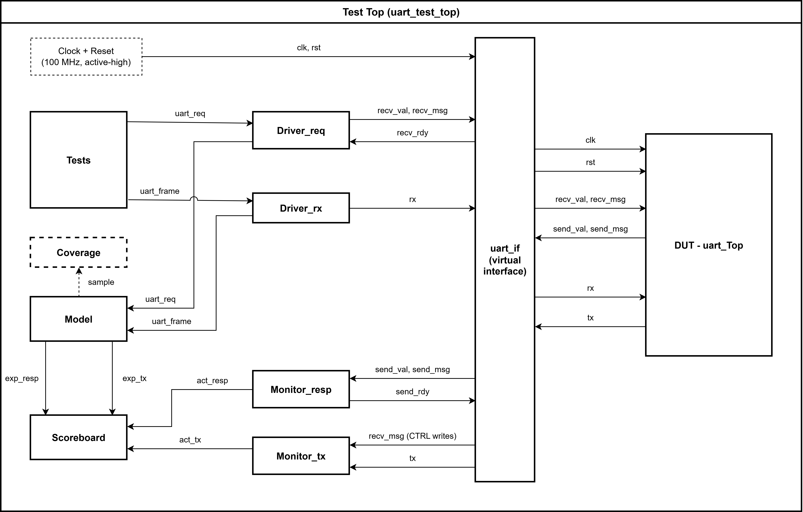

# UART SystemVerilog Testbench

A self-checking SystemVerilog testbench for a memory-mapped UART, built as part of
[Cornell Custom Silicon Systems (C2S2)](https://github.com/<c2s2-org>). It has a reference model, a
scoreboard that checks both TX and RX paths, functional coverage, and 11 directed tests
targeting register behavior, FIFO corner cases, error handling and mid-transfer aborts.

## Design Under Test

`uart_Top` is a UART with a valid/ready register interface on the host side and serial
`tx`/`rx` lines on the other. It runs at 100 MHz with 16x oversampling and has
8-entry TX and RX FIFOs.

| Offset | Register | Behavior |
|--------|----------|----------|
| `0x0`  | TXDATA   | Write enqueues a byte for transmission; read returns 0 |
| `0x4`  | RXDATA   | Read **peeks** the front byte (0 if empty); write **pops** it |
| `0x8`  | STATUS   | FIFO level bits + sticky error flags (write-1-to-clear) |
| `0xC`  | CTRL     | `[0]` enable, `[31:16]` baud divisor (a zero divisor prevents enabling) |

STATUS bits checked by the testbench:

| Bit | Meaning | Type |
|-----|---------|------|
| RX available / RX full | RX FIFO level | Read-only |
| 2 | TX FIFO empty | Read-only |
| 3 | TX FIFO full | Read-only |
| 5 | Frame error (bad stop bit) | Sticky, W1C |
| 6 | RX overrun (byte received while RX FIFO full) | Sticky, W1C |
| 7 | TX overflow (write while TX FIFO full) | Sticky, W1C |

## Testbench Architecture



The testbench (`uart_test_top`) connects to the DUT through a single virtual interface
(`uart_if`) and checks both directions of the UART independently:

- **Host → serial (TX path):** Tests issue `uart_req` register accesses. `Driver_req` drives
  them into the DUT over the `recv_val / recv_msg / recv_rdy` handshake. `Monitor_tx` follows
  CTRL writes to track the current baud divisor, decodes the `tx` line into frames, and sends
  them to the scoreboard as `act_tx`.
- **Serial → host (RX path):** Tests create `uart_frame` objects (data + optional bad stop bit).
  `Driver_rx` serializes them onto `rx` at any divisor. It can also inject malformed traffic,
  such as false start bits or partial frames. `Monitor_resp` acts as the host-side sink,
  driving `send_rdy` and capturing every register response as `act_resp`.
- **Checking:** Every request and frame also goes to a reference `Model`, which tracks
  FIFO contents, enable state and sticky flags. It predicts `exp_tx` and `exp_resp`, and the
  `Scoreboard` compares them against the actual values for both paths.
- **Coverage:** The model samples coverage *before* applying each transaction's side
  effects, so FIFO level and enable state reflect what the DUT actually saw.

| Component     | Role |
|---------------|------|
| Clock + Reset | 100 MHz clock, active-high reset |
| Tests         | Directed stimulus: `uart_req` register accesses and `uart_frame` serial frames |
| Driver_req    | Drives host-side requests via valid/ready handshake |
| Driver_rx     | Serializes frames onto `rx`; injects bad stop bits, false starts, partial frames |
| Monitor_tx    | Decodes `tx` using the divisor tracked from CTRL writes |
| Monitor_resp  | Host-side sink: applies `send_rdy`, captures responses |
| Model         | Reference model of registers, FIFOs and sticky flags |
| Scoreboard    | Compares expected vs. actual TX frames and register responses |
| Coverage      | Six covergroups sampled from the model |

## Tests

| # | Test | What it verifies |
|---|------|------------------|
| 1 | `uart_directed_smoke` | Enable, register readback, one TX byte, one RX byte, peek vs. pop, empty read returns 0 |
| 2 | `uart_directed_ctrl` | CTRL reset value; zero divisor blocks enable; enable/disable keeps the divisor |
| 3 | `uart_directed_tx_patterns` | 8 TX data patterns (`00 FF 55 AA 01 80 3C C3`) serialized correctly |
| 4 | `uart_directed_rx_fifo` | Fill RX FIFO, check ordering; a bad frame mid-fill is dropped without corrupting queued data |
| 5 | `uart_directed_rx_bad_stop` | Bad stop bit rejected; receiver recovers; pop on empty FIFO is a no-op (no underflow) |
| 6 | `uart_directed_status` | RX level bits, frame-error and overrun sticky flags, W1C (incl. clearing both at once), FIFO drain order |
| 7 | `uart_directed_rx_false_start` | Short glitch on `rx` rejected as a false start; no data or error flags; recovery |
| 8 | `uart_directed_rx_disable` | Disable mid-frame drops the partial byte; queued data still drainable while disabled |
| 9 | `uart_directed_tx_disable` | Disable during TX START and DATA states; `tx` must return to and stay idle-high |
| 10 | `uart_directed_tx_overflow` | Fill TX FIFO while disabled; 9th write sets sticky overflow; W1C clears flag but FIFO stays full |
| 11 | `uart_directed_baud_rates` | TX + RX at divisors 1, 7, 27, 54, 651 (fastest, 921600, 230400, 115200, 9600 baud); config-only at 0 and `0xFFFF` |

Each test states its expected number of register responses and TX frames, so the scoreboard
catches dropped *or* extra transactions as well as data mismatches.

## Functional Coverage

| Covergroup | What it measures |
|------------|------------------|
| `cg_req` | Read/write × every register × UART enabled/disabled |
| `cg_ctrl` | Enable/disable × baud divisor (0, 1, max, common baud rates, other) |
| `cg_tx` | TX data byte (`00`, `FF`, other) |
| `cg_status` | W1C patterns: none, each flag alone, multiple flags at once |
| `cg_frame` | RX data × good/bad stop bit × RX FIFO level (empty / partial / full) |
| `cg_rx_access` | Peek/pop × RX FIFO level (empty / one / partial / full) |

**Results:** All directed test cases passed with 0 scoreboard mismatches.

| Covergroup | Coverage |
|------------|----------|
| requests   | 100 % |
| ctrl       | 100 % |
| tx         | 100 % |
| status     | 100 % |
| rx access  | 100 % |
| rx frames  | 100 % |

## How to Run

Requirements: synopsys vcs

```bash
cd build
make           
```

## Bugs Found


## Authors

Testbench designed and implemented by **Raidul <last name>** and **Kevin <last name>**
(<!-- TODO: Kevin's GitHub handle -->). The UART RTL was developed by the C2S2 RTL team.

## Acknowledgments

[Cornell Custom Silicon Systems (C2S2)](https://github.com/<c2s2-org>)